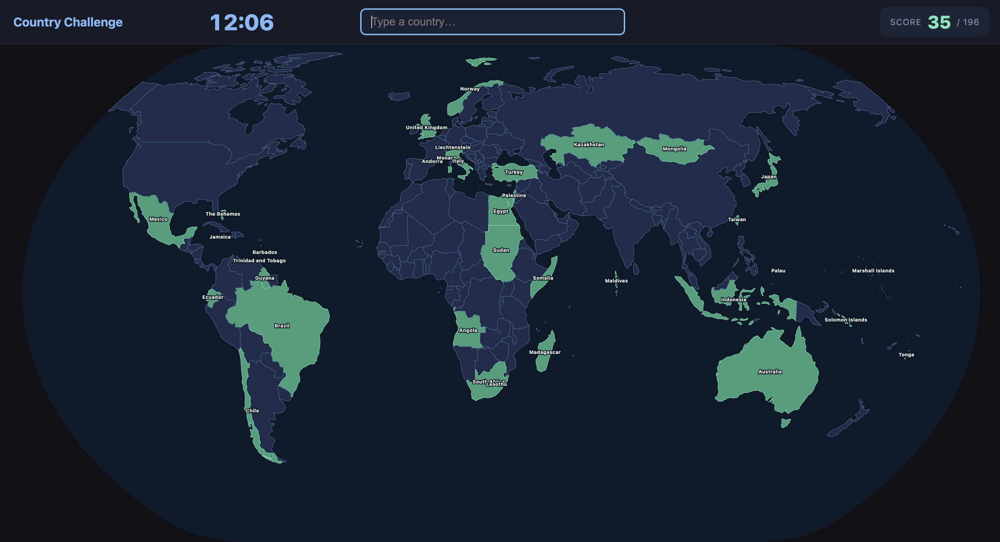

# Country Challenge

A geography game where you have 15 minutes to name as many countries as possible. Type a country name and press Enter — if it's correct, it lights up on the map.

The sidebar also tracks your **proximity penalty** (lower is better):

- Your first correct country is free.
- Each later correct country adds its distance to the **nearest previously guessed country**, in kilometers divided by **100**.
- The same rule applies to islands, mainland countries, and sea crossings. Shared borders have zero distance, so they add zero penalty.

Distances are approximate shortest border/coastline distances on the game's simplified map, including all mapped parts of each country. The penalty is accumulated without a cap and displayed to one decimal place. Each penalty stays fixed when the answer is accepted; later guesses do not recalculate earlier penalties. Wrong and duplicate guesses do not change the score, and replay resets it.



## Try it online

Play directly at **https://abuelhassan.github.io/country-challenge/** — no setup needed.

## How to run locally

**Option 1 — Python** (no install needed if Python is available):
```bash
python3 -m http.server 8080
```
Then open [http://localhost:8080](http://localhost:8080) in your browser.

**Option 2 — Node.js** (no install needed if Node.js is available):
```bash
npx serve .
```
Then open the URL shown in the terminal.

## Regenerating scoring data

After changing country geometry, regenerate the merged map using the existing workflow, then run:

```bash
node scripts/build_proximity.cjs
node --test tests/proximity.test.cjs
```

The generator writes `proximity.json`, containing the country-to-country distance matrix. It uses only Node's built-in modules. `scripts/proximity-config.json` contains corrections for real shared land borders that the simplified geometry does not capture accurately; rebuild after changing those too. The tests check that the generated data matches both inputs.
